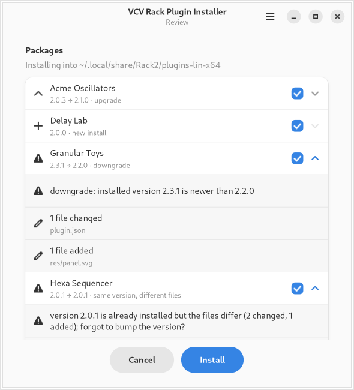

# VCV Rack Plugin Installer

Inspect, compare and install [VCV Rack 2](https://vcvrack.com/) plugin packages (`.vcvplugin`) on Linux,
from a GTK 4 / libadwaita app or from the command line.

Rack unpacks `.vcvplugin` files from its plugins folder the next time it starts, without saying what changed.
This installer checks each package first, shows what installing it will do, and unpacks it right away:

- rejects packages built for another OS or CPU, or without a valid `plugin.json`
- reports a new install, upgrade or downgrade, and asks before downgrading
- warns when the same version is already installed with different files (a rebuild without a version bump)
- replaces older packages that are still waiting for Rack to unpack them, so Rack won't unpack them over the new install
- unpacks into a staging folder and swaps it into place, so an interrupted install leaves no half-written plugin
- warns when Rack is running, and can start Rack when it's done

Open packages from your file manager, or drop several onto the window.



## Requirements

- Linux on x86-64 (Rack's `lin-x64` plugins)
- Python 3.11 or newer
- For the GUI: PyGObject with GTK 4.10+ and libadwaita 1.4+
- For Rack 2 packages, which are `tar.zst`: Python 3.14+, the `zstandard` module, or the `zstd` command

| Distribution  | Command |
|---------------|---------|
| Debian/Ubuntu | `sudo apt install python3-gi gir1.2-gtk-4.0 gir1.2-adw-1 zstd meson` |
| Fedora        | `sudo dnf install python3-gobject gtk4 libadwaita zstd meson` |
| Arch          | `sudo pacman -S python-gobject gtk4 libadwaita zstd meson` |

## Installation

### For your user (GUI and CLI)

```sh
git clone https://github.com/un1tz3r0/vcvplugin-installer.git
cd vcvplugin-installer
./install-desktop-files.sh              # install or update into ~/.local
./install-desktop-files.sh --uninstall  # remove it again
```

The script checks dependencies, installs into `~/.local` (or `$PREFIX`) with Meson, and makes the GUI the default
handler for `.vcvplugin` files.

### With Meson (system-wide, or for packaging)

```sh
meson setup _build --prefix=/usr/local
meson test -C _build        # validates the .desktop and AppStream files
sudo meson install -C _build
```

Meson installs the launchers to `bin/`, the Python package to `share/vcvplugin-installer/`, and the desktop entry,
AppStream metainfo, MIME type and icons to the usual places under `share/`. It doesn't set the default handler, so
to choose it over the terminal variant, run:

```sh
xdg-mime default io.github.un1tz3r0.VcvPluginInstaller.desktop application/x-vcvplugin
```

### CLI only, with pipx

```sh
pipx install 'vcvplugin-installer[zstd] @ git+https://github.com/un1tz3r0/vcvplugin-installer.git'
```

The `[zstd]` extra adds the `zstandard` module on Python < 3.14. `vcvplugin-gui` is installed too, but needs
PyGObject: pass `--system-site-packages` to pipx to use your distribution's. This route installs no desktop entry
or file association.

## Usage

### GUI

Open a `.vcvplugin` file from your file manager, or run `vcvplugin-gui [PACKAGE.vcvplugin ...]`. The wizard
inspects the packages, lets you pick which to install, asks before installing any that need confirmation, and
then shows the progress.

### Command line

```
vcvplugin-install [options] PACKAGE.vcvplugin [PACKAGE.vcvplugin ...]
```

| Option | |
|---|---|
| `-y`, `--yes` | proceed past warnings (downgrades, same-version rebuilds, …) |
| `-i`, `--interactive` | ask before proceeding past warnings |
| `--reinstall` | install even when the identical version is already installed |
| `--defer` | copy the package for Rack to unpack on its next start instead of unpacking now |
| `-n`, `--dry-run` | only report what would happen |
| `-q`, `--quiet` | only report problems |
| `--wait` | wait for Enter before exiting (for terminal launchers) |
| `--version` | print the version and exit |

Exit status: `0` all done, `1` some package failed or was rejected, `2` some package was skipped because it needs
confirmation (see `--yes`), `3` both.

### Environment

| Variable | Default | |
|---|---|---|
| `RACK_USER_DIR` | `~/.local/share/Rack2` | Rack user folder; plugins go into its `plugins-lin-x64/` |
| `RACK_EXECUTABLE` | `Rack` on `PATH`, else `~/Rack2*/Rack`, `/opt/Rack2*/Rack`, … | used by the GUI's *Start Rack2* button |

## Development

Run from a checkout without installing:

```sh
python3 -m vcvplugin --help   # CLI
python3 -m vcvplugin.gui      # GUI
```

| Path | |
|---|---|
| `vcvplugin/core.py` | package inspection, comparison and installation (no GUI dependencies) |
| `vcvplugin/cli.py`, `vcvplugin/gui.py` | command-line and GTK 4 / libadwaita front ends |
| `data/` | desktop entries, AppStream metainfo, MIME type, icon |
| `vcvplugin/VERSION` | the version, read by Meson, hatchling and the app itself |
| `meson.build` | desktop installation |
| `pyproject.toml` | Python packaging (sdist/wheel, pip/pipx) |
| `tests/` | pytest suite for `core` and `cli` |
| `build-aux/screenshots.py` | renders `data/screenshots/` from a scripted GUI run |
| `build-aux/release-notes.py` | prints the metainfo release notes for the current version |

See [CONTRIBUTING.md](CONTRIBUTING.md) for running the tests, the version-bump rule and the release process.

## License

Copyright © 2026 Victor Condino

This program is free software: you can redistribute it and/or modify it under the terms of the GNU General Public
License as published by the Free Software Foundation, either version 3 of the License, or (at your option) any later
version. See [LICENSE](LICENSE).
